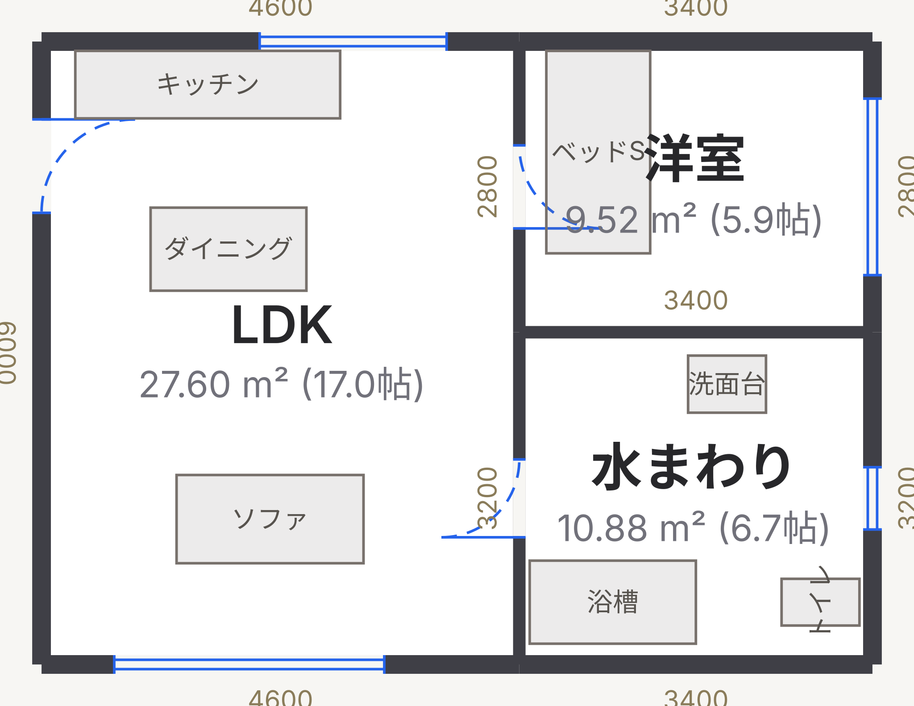

# MiniCAD

間取り作図に特化した、小さな CAD 風 Web アプリ。Vite + TypeScript + Canvas 2D のみで、
実行時の依存ライブラリはゼロ。



```bash
npm install
npm run dev        # http://localhost:5180
npm test           # 幾何・部屋検出・I/O のテスト (Node、依存なし)
npm run test:e2e   # 実ブラウザでの通し確認 (Playwright)
npm run build      # 型チェック + 本番ビルド
```

---

## できること

| | |
|---|---|
| **汎用図形** | 線・ポリライン・円・円弧・文字・点。間取りの意味を持たない図形で、敷地・庇・注記などに使う |
| **複写・回転・鏡像** | 選択に対するアフィン変換。壁を複写するとノードごと複製され、元とは繋がらない。鏡像ではドアの開き勝手が見た目どおり反転する |
| **オフセット・トリム・延長** | 汎用図形と壁の両方に効く。切断要素を選ばせないクイックトリム方式 |
| **壁** | 連続作図。端点はノードとして共有されるので、角を掴んで動かせば接続した壁が全部ついてくる。既存の壁の途中をクリックすると壁を分割して本当に接続する |
| **部屋** | 壁で閉じた領域を**自動検出**。壁芯面積・内法面積・帖数を常時表示 |
| **開口部** | ドア・窓・開口。壁の上にしか置けず、壁を伸ばしても位置がズレない。開き勝手の反転あり |
| **ブロック** | 名前付きの部品。標準11種に加え、選んだ図形をブロックにできる。近くの壁に自動で背を向けて沿う（Alt で解除） |
| **寸法** | 任意の2点間に置ける実体のエンティティ。端点を壁の角に紐づけると、角を動かしたときに値が追従する |
| **幾何拘束** | 壁に水平・垂直・平行・直角・長さを付けると、以後の編集で保たれる。自前の最小二乗ソルバ |
| **3D 表示** | 壁を押し出して立体で確かめる。開口が抜け、腰壁とまぐさが見える。依存ライブラリなしの自前描画 |
| **立面図** | 開口のある壁を SVG で起こす。腰壁・まぐさ・**高さ方向の寸法**が入る |
| **計測** | 2点間の距離と角度 |
| **製図規格** | JIS の線群・文字高さ・尺度・用紙をプリセットで選べる（強制はしない） |
| **画層** | 壁・建具・家具・寸法・室名などに分かれ、表示/線種/線の太さを切り替えられる |
| **用紙枠・表題欄** | JIS Z 8311 の輪郭線と表題欄。画面にも出せる。尺度と用紙の設定がここで初めて意味を持つ |
| **保存** | JSON（自動保存あり）/ SVG / **DXF (R12)** 書き出し（Jw_cad 用の Shift-JIS も）/ 実寸での印刷 |
| **数量** | 部屋ごとの床・天井・壁の面積、周長、開口、員数を**実測 JSON** で書き出し。[QuantityTakeoff](https://github.com/24th-garnet/QuantityTakeoff) が食べて見積りの数量にします |

## CAD らしさの中身

ただのお絵描きツールと分けているのは次の2点です。

**1. オブジェクトスナップ** — 優先度は 端点 > 中点 > 交点 > 壁上 > 角度 > グリッド。
オブジェクトスナップが効いたときは角度・グリッドより常に優先します（作図者の意図に近いため）。
実装は [src/core/snap.ts](src/core/snap.ts)。

**2. 数値入力** — 数字キーを押すと入力欄が開きます。方向はマウス、長さはキーボード、という CAD の作法です。

| 入力 | 意味 |
|---|---|
| `3000` | 現在の方向（角度スナップ後）に 3000mm |
| `3000<90` | 真上に 3000mm（相対極座標） |
| `1000,2000` | 絶対座標 |
| `@1000,2000` | 相対直交座標 |

**角度の区切りは `<` のみ、`,` は常に直交座標、`@` が相対**です
（AutoCAD / JW_CAD / LibreCAD と同じ約束）。全角で打たれても NFKC で畳んで受けます。

作図中だけでなく、**選択ツールで何かを選んでいるときにも使えます**（`@0,-500` で選択を下へ 500mm）。
壁ツールは作図を始める前でも入力欄を出すので、絶対座標で始点を置けます。

## 製図規格と画層

JIS は任意規格なので、MiniCAD も**プリセットとして用意するだけで準拠は強制しません**（市販CADと同じ作りです）。

| 項目 | 規格 | 用意しているもの |
|---|---|---|
| 線の太さ | JIS Z 8312 | 0.13〜2.0mm の9種から、細線:太線:極太線 = **1:2:4** の線群を5組 |
| 文字高さ | JIS Z 8313 | 1.8 / 2.5 / 3.5 / 5 / 7 / 10 / 14 / 20mm（公比 √2） |
| 尺度 | JIS Z 8314 | 1:20 / 1:50 / 1:100 / 1:200 / 1:500 |
| 用紙 | JIS Z 8311 | A0〜A4。輪郭線の余白は A0・A1 が 20mm、A2〜A4 が 10mm、とじ代は一律 20mm |
| 建具記号 | JIS A 0150 | 扉5種・引戸3種・窓2種（下表） |

### 建具記号（JIS A 0150）

| ツール | 種別 | 記号 |
|---|---|---|
| ドア | 片開き戸 | 扉1枚と 1/4 円弧 |
| | 両開き戸 | 中央で突き合う扉2枚と円弧2本 |
| | 親子扉 | 子扉 1/3・親扉 2/3 に割った両開き |
| | 引違い戸 | 壁芯上の障子線と、中央の召し合わせの印 |
| | 片引き戸 | 引き残し側をかくれ線にした障子線 |
| | 引込み戸 | 障子線と、壁の中の戸袋（かくれ線入りの箱） |
| | 折戸 | 2山の折れ線 |
| | 出入口（建具なし） | 召し合わせの印のみ |
| 窓 | 窓 | 壁厚の中の平行線2本 |
| | 引違い窓 | 上記＋中央の召し合わせの印 |

はめごろし窓・上げ下げ窓・すべり出し窓・回転窓などは、**規格上どれも平面では同じ記号**になり
（区別は建具符号と注記で行う）、`窓` 1種で足ります。種別を足したいときは
`src/core/opening.ts` の `OPENING_SYMBOLS` に1行書けば、画面・SVG・DXF・インスペクタの
すべてに同時に反映されます。

記号はブロック（DXF の INSERT）ではなく**関数**で組んでいます。召し合わせの印や戸袋の見切りは
開口幅に依存しない一方、障子線の長さだけが幅に比例するので、2軸の尺度しか持たない INSERT では
表せないためです（円弧を含む記号が非一様尺度で楕円になる、という事情もあります）。

線の太さは**紙の上の mm** で持ち、尺度を介してワールド座標に換算します（1:100 なら 0.5mm の線は 50mm 幅）。
画面上では CAD の線幅表示と同じく、ズームに依らず一定のピクセル数で描きます。

画層は線の太さを「細線 / 太線 / 極太線」という**役割**で持つので、線群を切り替えるだけで図面全体の太さが揃います。
画層は DXF の LAYER テーブルにそのまま対応します。

**画層の操作**

- 追加・改名・色 (ACI)・線種・太さの役割の変更、削除
- **表示**を切ると描画からも当たり判定からも消えます。**ロック**すると選択できなくなりますが、
  スナップは効いたままです（ロックした下図に合わせて線を引く、という CAD の使い方に合わせています）
- 「新規作成の画層」を指定すると、以降に描いたものがその画層に乗ります。未指定なら種別ごとの既定
  （壁は `A-WALL`、文字は `A-ANNO-TEXT` …）
- 選択したものの画層は、プロパティ欄からまとめて変えられます
- 組み込みの9画層は削除できません（`getLayer` と既定画層のフォールバック先のため）。
  追加した画層を消すと、中身は種別ごとの既定へ移ります
- 画層名は常に一意に保たれます。DXF の LAYER テーブルは名前が重複するとマージされてしまうためです

## 3D を DXF で書き出す

3D ビューが使っているメッシュを、そのまま `3DFACE` にして出します。
**新しい幾何は書いていません。** 面が**どのエンティティから出たか**を覚えている
ので（`Face3.ref`）、画層もそこから引けます。平面の画層とは別の名前
（`A-WALL-3D` など）にして、読み込んだ側で切り分けられるようにしています。

**R12 が持てる立体は `3DFACE`（3〜4 点の平らな面）だけ**ですが、MiniCAD の
メッシュは最初から平らな面の寄せ集めなので（ペインターズ法で描くために
曲面を持たない作りにしてあります）、落とすものがありません。

5 点以上の面（L 字の床など）だけは**扇状に割ります**。当たり判定で扇状分割を
使うと凹多角形で単純に誤るので `pointInPolygon` を使っていますが、書き出しは
見た目が出れば足りるので、凹んだ側に余分な面が出るだけです。**それでも余分は
余分なので、割ったことを報告します。** 素材と色が出ないことも書きます。

## 立面図

開口のある壁を選んで、壁ごとの立面を SVG で書き出します。

**新しい幾何は書いていません。** 3D の押し出し（`src/render3d/mesh.ts` の `extrudeWall`）が
既に `(lo, hi, sill, head)` の 4 つ組で開口の矩形を決めているので、立面はそれを高さ方向に
潰しただけです。

| 要る数 | 出どころ |
|---|---|
| 壁の長さ・開口を抜いた区間 | `wallSpans` |
| 壁の上下端 | `level.floorZ` と `wallHeightOf` |
| 開口の壁上の位置 | `WallHole.lo / hi` |
| 開口の上下端 | `openingVertical` |

**高さ方向の寸法が初めて入ります。** 平面図の寸法はすべて水平方向なので、
階高と開口の高さが図面に出るのはここが最初です。

**建具の割付は描きません。** 引違いの召し合わせも、サッシの框も、開き勝手も、
**寸法として持っていない**ためです。外形と開口の矩形までを出し、
「建具の割付は未計測です」と図面に書きます。描けるふりをするより、
何を持っていないかを図面に残すほうが受け取る側に親切です。

## 他の CAD との連携（DXF）

### 書き出し

**DXF R12 (AC1009)** で書き出します。R12 を選んだのは、構造が単純でハンドル管理が不要なぶん、
LibreCAD / QCAD / JW_CAD / AutoCAD のどれでも素直に開けるからです。

- 座標はワールドの mm を **1:1** で出力（`$INSUNITS = 4`、`$MEASUREMENT = 1`）。尺度は紙に出すときの話、というCADの流儀に合わせています
- 画層・線種はテーブルごと出力。非表示の画層は色番号を負にして渡します
- 壁は**開口部を抜いた線分**として出るので、受け取った側でそのまま編集できます

**割り切っている点**

- **線の太さは色 (ACI) で運びます。** R12 には画層の線幅という概念がないためで、日本のCAD運用で
  昔から使われてきた「色＝線の太さ」の対応と同じです。正確な mm 値は MiniCAD の JSON 側に残ります
- **寸法は本物の `DIMENSION` エンティティ**で出すので、受け取った側で寸法として編集できます。
  R12 の寸法は「DIMENSION エンティティ＋線と文字の実体を持つ無名ブロック」という二重構造で、
  読めない受け手のために作図設定から線と文字へのフォールバックも選べます
- **文字コードは宣言します**（`$DWGCODEPAGE`）。受け手はこれを見て読み方を決めるので、
  **宣言と中身を食い違わせません**。既定は UTF-8、Jw_cad へ渡すときは Shift-JIS（下記）
- 日本語を `\U+XXXX` にエスケープするオプションもあります（作図設定）

### Jw_cad へ渡す

**Jw_cad は Shift-JIS しか読めません。** UTF-8 のまま渡すと室名も表題欄も文字化けします。
作図設定の「DXFをShift-JISで書く (Jw_cad 用)」を入れると、cp932 で書き出し
`$DWGCODEPAGE` も `ANSI_932` に切り替わります。

**符号化表は同梱していません。** ブラウザにも Node にも Shift-JIS の*符号化器*は無く
（`TextEncoder` は UTF-8 専用）、表を持つと数十 KB のデータを抱えることになります。
代わりに**復号器から符号化表を起こします** — `TextDecoder('shift_jis')` は標準で使えるので、
2 バイト列を総当たりして文字へ直し、その逆を表にする。実測で **9,604 字**が起こせます
（JIS X 0208 ＋ NEC/IBM 拡張）。これで**データを 1 バイトも持たずに**符号化できます。

Shift-JIS に無い字（絵文字など）は `?` になりますが、**黙って落とさず何字落ちたかを知らせます**。

**JWW 形式では書き出しません。** 公開仕様もオープンな実装も無い独自バイナリで、Jw_cad は
DXF R12 を読めるので、**実質的な答えは「Jw_cad で確実に開ける DXF」**です。
DWG も同じ理由で書きません（GNU LibreDWG は GPLv3 の C ライブラリで、
実行時依存ゼロという方針と合いません）。DWG が要るときは DXF を外部のコンバータに通します。

### 読み込み

「開く」から `.dxf` を選ぶと読み込めます。R12 に限らず、AutoCAD 2018 形式のように
ハンドルやサブクラスマーカが入ったファイルもそのまま読めます。

| DXF | 取り込み先 |
|---|---|
| LINE / CIRCLE / POINT | 線 / 円 / 点 |
| LWPOLYLINE / POLYLINE | ポリライン（`bulge` があれば線分と円弧に分解） |
| ARC | 円弧 |
| TEXT / MTEXT | 文字（MTEXT は改行ごとに1行ずつ） |
| INSERT / BLOCK | ブロック挿入 / ブロック定義（入れ子は図形に展開） |
| DIMENSION | 参照先のブロックを展開して線と文字に |
| ELLIPSE | 比が1なら円・円弧、それ以外は折れ線 |
| SOLID / 3DFACE | 閉じたポリライン（塗りは落ちます） |
| SPLINE / HATCH / LEADER ほか | 読み飛ばし（件数と理由をレポートに出します） |

**取り込んだ線は「下図」として汎用図形になります。壁にはしません。** 他所の DXF には
通り芯・寸法線・ハッチが混ざっているので、平行線のペアから壁を推定すると誤検出が
そのまま「部屋が検出されない」に化けます。下図を見ながら壁ツールでなぞり直すほうが
速く、結果も正しくなります。画層 `A-DRAFT` は元々この用途のためにあります。

その他の約束:

- **文字コードは自動判定**します。`$DWGCODEPAGE` を見て Shift_JIS / UTF-8 を切り替え、
  指定が無ければ UTF-8 として読み、壊れていれば Shift_JIS に落とします
  （JW_CAD や古い AutoCAD の出力は Shift_JIS のことが多いため）
- **単位は `$INSUNITS`** から mm への倍率を決めます。指定が無いファイルは mm とみなしますが、
  取り込みダイアログで変更できます（黙って 1/25.4 の大きさで読むと原因が分からなくなるため）
- **同名の画層・ブロックは再利用**します。自分で書き出した DXF を読み戻すと元の画層・
  標準ブロックに戻り、読み込みを繰り返しても定義が増えません。ただし既存画層の色や
  線種は上書きしません（読み込みで手元の図面の見た目が変わるのは事故なので）
- **押し出し方向 (`210`/`220`/`230`) が `z = -1`** のエンティティは鏡像として正規化します。
  無視すると他の CAD で作ったドアの開き勝手が左右逆になります
- 取り込みは 1 回の undo で丸ごと取り消せます

**DXF パーサは自前**です（`src/io/dxfTags.ts` + `src/io/dxfRead.ts`）。
[dxf-parser](https://www.npmjs.com/package/dxf-parser) は実行時の依存を増やす（孫依存に
ロガーまで付いてくる）わりに、肩代わりしてくれるのはタグ読みの部分だけで、文字コード判定・
OCS の正規化・`bulge` の変換・`Shape` への変換はどちらにせよ自前で書く必要があります。
代わりに dxf-parser は開発時の依存として残し、**同じ DXF を両方で読んで突き合わせる差分テスト**に
使っています（`tests/dxfRead.test.ts`）。ライブラリを採用すると、そのバグがそのまま自分のバグに
なって比較対象が消えるので、検証としてはこちらのほうが強くなります。

## 組み込む

業務アプリ（ホスト）の中に作図エディタとして埋め込めます。

```ts
import { mount } from './src/mount.ts';

const cad = mount(document.getElementById('editor')!, {
  scene: await loadFromServer(),
  onChange: (file) => void save(file),
});
```

`capabilities: { edit: false }` を渡すと閲覧のみになります。**その保証は画面ではなく
[src/core/store.ts](src/core/store.ts) が持ちます** — 道具やボタンを消すのは行き止まりを
減らすためで、インスペクタの入力欄もドラッグもショートカットも別の経路で書きに来るからです。
図面を書き換える経路（`commit` / `commitFrom` / `undo` / `redo`）は 1 箇所なので、
そこで止めれば漏れません。

`catalogs` で挿せる部品の一覧を渡せます。**マスタはホストが持ち**（検索・公開・
いいね・DL 数はすべてホストの仕事）、MiniCAD は絞り込み済みの一覧を受け取って挿すだけです。
渡さなければ、図面が持っているブロック定義がそのままパレットに出ます。

契約は [docs/host.md](docs/host.md)。**何をホストが持ち、何を MiniCAD が持たないか**を
先に決めてあります（認証・案件・保存・版管理・コメントの通信・ライブラリのマスタ・
写実レンダリング・単価と金額は、すべてホスト側）。

**単体の立ち上げ（[src/main.ts](src/main.ts)）がこの契約の最初の利用者です。**
図面を渡し、変わったら保存する——ホストに頼んでいることと同じことを自分でやっているので、
契約が飾りになりません。

## 編集モード

上部バーで**通常**と**プロモード**を切り替えます。**既定は通常モード**です。

| | 出るもの |
|---|---|
| 通常 | 壁・建具・ブロック・部屋名・寸法・線・円弧・文字・複写・回転・鏡像・計測 |
| プロモード | 上の全部 ＋ オフセット・トリム・延長・点・幾何拘束・製図規格・用紙枠 |

**切り替えで変わるのは出す道具だけで、図面は何も変わりません。** 第 2 の実装は
持たず、差は [src/ui/tool-registry.ts](src/ui/tool-registry.ts) と
[src/ui/section-registry.ts](src/ui/section-registry.ts) の `modes` 欄にしかありません。
隠したツールは**登録そのものから外す**ので、ショートカットでも選べず、
ショートカット一覧にも出ません（表示だけ消すと、見えないのに効くツールが残ります）。

**プロモードは通常モードを狭めません。** 仕様（ワイヤー）のプロモードは汎用ソリッドの
作図（直方体・円筒・押し出し・プッシュ/プル・ブーリアン）で、「壁は通常モードを利用する前提」と
書かれています。字義どおりに壁を外すと、入るはずの汎用ソリッドがまだ無いので**空のモード**に
なってしまいます。そこで通常の道具立てはプロでもそのまま出し、**足りないものは
プロモードの画面に「まだ無いもの」として並べて**います。埋まったらその欄が消えます。

## 操作

| キー | 動作 | | キー | 動作 |
|---|---|---|---|---|
| `V` / `M` | 選択 / 計測 | | ドラッグ | 移動 / 範囲選択 |
| `Y` / `R` / `X` | 複写 / 回転 / 鏡像 | | `Alt`+ドラッグ | 複写しながら移動 |
| `O` / `U` / `E` | オフセット / トリム / 延長（プロ） | | `G` / `F8` | グリッド / 直交スナップ切替 |
| `W` | 壁 | | 中ドラッグ・`Space`+ドラッグ | 画面移動 |
| `D` / `S` | ドア / 窓 | | ホイール | 拡大縮小 |
| `B` | ブロック | | 中ドラッグ | 画面移動 |
| `K` | 構造（柱・梁・階段・吹抜） | | `0` | 全体表示 |
| `L` / `C` | 線 / 円・円弧 | | `F3` | 3D を出す / 2D に戻す |
| `Q` / `T` | 点（プロ）/ 文字 | | `[` `]` | 家具を回転 |
| `H` / `N` | 寸法 / 部屋名 | | `Esc` | 作図の取り消し・選択解除 |

ツールの中で使うキー（家具ツールの `R`、建具ツールの `X`/`Y`）は、そのツールを使っている間だけ
ツール側が受け取ります。ツール切替のキーより優先されます。
「（プロ）」の付いたものはプロモードでだけ出ます。

**選択ツール以外を選ぶと 2D に戻ります。** 3D では作図できないので、3D を見たまま
壁ツールを選んでも何も起きない行き止まりになるためです。

範囲選択は左→右が完全包含、右→左が交差選択（AutoCAD 以来の作法）。
ツール個別の操作は画面下のステータスバーに常時出ます。

## 設計

ワールド座標は **mm 単位・y 軸上向き**（建築図面の流儀）。画面への y 反転は `Viewport` だけが担当します。

```
src/
  core/      ドメイン。DOM に一切触らない
    geometry.ts  ベクトル演算・線分交点・ポリゴン面積
    types.ts     エンティティ定義 (Node/Wall/Opening/Furniture/RoomLabel/Shape)
    entity.ts    種別ごとの操作をまとめた表。種別を足すと型エラーで漏れが分かる
    selection.ts 選択の展開と移動
    transform.ts    アフィン変換。移動・回転・鏡像を1つの型で表す
    transformOps.ts 選択への変換の適用。複写もここ
    shapes.ts    汎用図形のユニオンと幾何の表
    coord-input.ts 座標入力の解釈。文字列を触るのはここだけ
    modify.ts    オフセット・トリム・延長。図形と壁を同じ Curve に乗せて扱う
    sheet.ts     用紙枠と表題欄の幾何
    block.ts     ブロック定義と挿入
    blockPresets.ts 標準ブロック（旧・家具プリセット）
    dimension.ts 寸法の幾何。寸法も図形ユニオンの一種
    primitive.ts 描画の中間表現。renderer / SVG / DXF が共有する
    standard.ts  製図規格のプリセット（線群・文字高さ・尺度・用紙）
    layer.ts     画層。DXF の LAYER テーブルに対応
    store.ts     シーンの単一の持ち主 + undo/redo
    ops.ts       壁の追加・分割・ノード統合などの編集操作
    rooms.ts     壁グラフの平面フェイス探索による部屋の自動検出
    snap.ts      スナップ解決
    pick.ts      当たり判定
    shape.ts     壁・開口の形状、壁の輪郭線、開き勝手の幾何
    opening.ts   建具の平面表示記号（JIS A 0150）の表
    fixture.ts   構造物（柱・梁・階段・スロープ・吹抜）の表
    bay.ts       出窓とニッチ。建具の種別は増やさない
    material.ts  素材。不透明な識別子を運ぶだけ
    annotation.ts 距離計測とコメントのアンカー
    view.ts      図面ビュー。画層ではなく紙空間のビューポート
    assembly.ts  シンボル。挿入は実体への展開（スタンプ）
  render/    Canvas 2D への描画。状態を持たない
  render3d/  3D 表示と 3D 編集
    camera.ts    軌道カメラ。視点の基底を 1 箇所で作る
    mesh.ts      壁・床・家具の押し出し。面は出どころを覚えている
    meshCache.ts 実体ごとのメッシュ。内容の指紋で作り直しを決める
    ray.ts       画面の点からワールドのレイ。交差は多角形のまま
    interact.ts  3D のポインタ。選択・ホバー・移動・壁の高さ
    fixture3d.ts 構造物の立体。階段は段で作る
    paint.ts     ペインターズ法
  tools/     ツール。Tool インターフェースを実装すれば追加できる
  host.ts    ホストとの境界の型
  mount.ts   埋め込みの入口
  io/        JSON / SVG / DXF / サンプル間取り
    dxf3d.ts     3D を 3DFACE で書き出す
  ui/        DOM。エディタ本体、パネル、インスペクタの各区画
    shell.ts          画面の骨組み。index.html ではなくここが組む
    mode.ts           通常モードとプロモード
    tool-registry.ts  何のツールを出すか
    section-registry.ts 何の区画を出すか
    view-state.ts     2D / 3D / 分割のどれを出しているか
tools/       開発用。DXF を外部パーサで読み戻して画像化する検証スクリプト
```

**図形を1種類足すときに書くのは3箇所だけ**です。`SHAPE_GEOMETRY`（幾何）、
`SHAPE_READERS`（JSON 読み取り）、`SHAPE_FIELDS`（プロパティ欄）。
いずれも `Record<ShapeKind, ...>` なので、書き忘れると `npm run typecheck` が止まります。
描画・SVG・DXF は中間表現（`Primitive`）を経由するので触る必要がありません。

**部屋検出** ([src/core/rooms.ts](src/core/rooms.ts)) が中核です。
各有向半辺 (u→v) に対し、v における逆辺 (v→u) から反時計回り順で1つ手前の出辺を次の辺とすると、
内部フェイスは反時計回り（符号付き面積が正）、外周フェイスは時計回り（負）になります。
正のものだけを部屋として拾えば、行き止まりの壁も開いた壁も自然に除外されます。

**状態管理** は Excalidraw 流に「状態は素のデータ、更新はスナップショット」で割り切っています。
`store.commit(fn)` が履歴に残る変更、`store.update(fn)` が残らない変更、
ドラッグのように途中経過を自由に書き換えたい操作は `store.commitFrom(before)` です。

## 参考にしたもの

調査の詳細は [docs/research-cad-references.md](docs/research-cad-references.md)。

- [LibreCAD](https://github.com/LibreCAD/LibreCAD) — 2D CAD の機能セットとツールの作法
- [Solvespace](https://github.com/solvespace/solvespace) / [FreeCAD Sketcher](https://github.com/FreeCAD/FreeCAD) — 拘束の考え方
- [Excalidraw](https://github.com/excalidraw/excalidraw) (MIT) — データモデルとレンダリングの構成
- [Sweet Home 3D](https://www.sweethome3d.com/) / [blueprint3d](https://github.com/furnishup/blueprint3d) (MIT) — 間取りエディタの操作系

GPL 系（LibreCAD, Solvespace, Sweet Home 3D）は挙動とUIの参考に留め、コードは引き写していません。

## テスト

- `npm run typecheck` が実質的な「分岐の網羅テスト」になります。図形の種別を足して
  上の3つの表のどれかを埋め忘れると、ここで止まります。
  **`src` だけでなく `tests` も対象**です。テストの外に置いていた頃は、テストが
  書いた不正な実体（必須の欄が欠けたまま）が型検査を素通りして実行時まで届いていました。
- **CI** は `.github/workflows/ci.yml`。typecheck → `npm test` → e2e をこの順で回します。
  テストは `tests/*.test.ts` をシェルで展開して渡します —— Node 22 のランナーは
  ディレクトリを渡しても `.ts` を見つけられないためです。
- `npm test` — 部屋検出（平面フェイス探索）、壁の分割と開口部の引き継ぎ、当たり判定、
  画層のロック、JSON の往復、SVG 出力の健全性、製図規格と画層の連動。
  Canvas は呼び出しを記録するスタブで差し替えているので、ブラウザなしで描画パス全体を通せます。
  DXF は書き出したものを **外部パーサ (`dxf-parser`) で読み戻して**検証しています
  （自前の思い込みで通ってしまわないように）。読み戻しの道具は
  [tests/dxf-oracle.ts](tests/dxf-oracle.ts) にまとめてあります —— `dxf-parser` の
  `IEntity` は宣言が実際より狭いので、**型を緩めるのはそこ 1 箇所に閉じて**います。
- `npm run test:e2e` — dev サーバを自分で起動し、Playwright で実際に壁を描き、
  数値入力で寸法を指定し、ドア・窓・家具を置き、角をドラッグして undo するところまで再現します。
  `-- --shots out/` を付けると各ステップのスクリーンショットが残ります。

## 用紙枠と表題欄

「用紙枠を表示」を入れると、選んだ用紙と尺度どおりの輪郭線が出ます。
A3・1:100 なら輪郭は **(420 − 20 とじ代 − 10 右) × 100 = 39000mm** 四方。
ここで初めて「この尺度でこの紙に収まるのか」が見えます。収まらない場合は
収まる尺度を提案します。

表題欄は輪郭内の右下に置かれ、図面名称・図面番号・企業名・責任者・尺度と作成年月日が入ります。
尺度の欄は設定から自動で埋まります。

**書き出しが変わります。** 用紙枠を出していると SVG は用紙の実寸（A3 なら `width="420mm"`）で
書き出され、**尺度を変えても紙の実寸は変わりません**。枠を出していなければ、これまで通り
図面の範囲で書き出します。

**印刷** は `@page` に用紙の実寸を指定した最小の HTML を別ウィンドウに開く方式です。
PDF 出力は自前で書いていません。日本語を PDF に埋めるには CID フォントのサブセット埋め込みが要り、
「実行時の依存ライブラリなし」という方針と正面衝突するためです。
ブラウザの「PDF として保存」ならベクタのまま、フォントも正しく出ます。

## 寸法

寸法は**実体のエンティティ**です。以前は「全ての壁に長さを自動表示する」オプションでしたが、
任意の2点間に置けない・個別に消せない・位置を動かせない、という制約がありました。

- 端点は**壁の角に紐づけられます**（作図時にスナップでノードを掴むと自動で紐づきます）。
  角を動かすと値が追従します
- 両端が角に紐づいているときは、ドラッグすると**出す位置（オフセット）だけ**が動きます。
  自由点を含むときは、その点ごと動きます
- 複写すると、紐づけはコピー側の角へ付け替わります。壁を複写せずに寸法だけ複写した場合は、
  自由点に落ちます（元の壁を測り続けないように）
- 値は「値の上書き」で差し替えられます（「約2730」など）。実測値は保たれます
- 表示の ON/OFF は画層 `A-DIMS` の表示で切り替えます

DXF には本物の `DIMENSION` エンティティとして出します。R12 の寸法は
「DIMENSION エンティティ＋線と文字の実体を持つ無名ブロック (`*D0` …)」という二重構造で、
`DIMSTYLE` テーブルも併せて書きます。受け手は寸法として編集でき、ブロックを展開するだけの
簡易ビューアでも見た目は同じになります（実際、展開した結果はフォールバック出力と
線分・文字が完全に一致します）。

寸法の種別は**整列寸法**（グループコード 70 = 33）です。回転寸法にすると値がコード 50 の
角度への投影で決まり、斜めの寸法で実測値と食い違うためです。端部は矢印ではなく 45 度の
斜線（`DIMTSZ` > 0）で、建築の流儀に合わせています。

R12 の `DIMENSION` を正しく読めない受け手のために、作図設定で**線と文字に分解する**出力も
選べます。

旧バージョンのファイル（自動表示だった頃のもの）は、読み込み時に全壁ぶんの寸法エンティティへ変換します。

## シンボル（壁を含むひとまとまり）

壁・建具・構造をまとめて**シンボル**にして、置けます。「2LDK ベース図面」の
ような部品がこれです。

**ブロックとは別の仕組みです。** `BlockDef` が図形しか持てないのは正しい設計で、
定義の中にノードグラフを置くと挿入ごとに複製が要り、部屋検出が壊れます。
`BlockDef` は DXF の `INSERT` に 1:1 で対応する本物のブロックなので、その性質を
崩すと相互運用が壊れます。

**だから挿入は「スタンプ」です** ——置いた瞬間に実体へ展開されます。壁もノードも
建具も本物として置かれるので、**部屋検出は無改造で効き、DXF もそのまま出ます**。
入れ子の座標系は作りません。由来は `Attrs.symbolId` と `symbolVersion` に残ります。

**README の「壁を含む入れ子ブロック定義は作らない」を破ってはいません。**
代わりに払う代償は、「同一シンボルの一括変更」が再スタンプになること —— 
**ローカルの編集を捨てうる**ので、何を上書きするかを先に報告してから行います。

ホストのカタログの `scene` 欄（壁を含む部品）も、この仕組みで置けます。

### 同一シンボルの一括変更

1 箇所を普通に編集して「この形で更新する」を押すと、シンボルの版が 1 つ上がります。
すると他の箇所が「古い版」になり、「古い N 箇所を押し直す」が出ます。

**押し直しは、消してから置き直します。** 差分を当てようとすると、どの実体が
どれに対応するかを決める必要があり、動かされていると当てようがありません。
消して置けば、結果は必ず「いまの版をそこに置いたもの」になります。

**だから、押す前に何が置き換わるかを必ず出します。** どの実体が手で直されたかは
分からない（直した印を持っていません）ので、**置き換わるもの全部**を数えて出し、
「それらに加えた編集は失われます」と書いて確認を取ります。undo 1 回で戻せます。

置いた箇所は `Stamp` として覚えています。置いた実体からは「どこに、どの向きで
置いたか」を正確には戻せない（動かされているかもしれない）ためです。

## ブロック

名前付きの図形の集合を、位置・尺度・回転を変えて何度でも挿入できます。
**以前の「家具」はブロックに統合されました。**

- 標準ブロック11種（ベッド・ソファ・キッチン・浴槽・階段 …）。中身は図形なので、
  記号ごとの描き分けが renderer から消えました
- 選んだ図形から**自分の部品を作れます**（方位記号、繰り返しの造作など）。
  分解すると図形に戻ります
- 寸法はこれまで通り mm で編集できます。内部では定義の自然な大きさとの比を尺度として持ちます
- 尺度は X と Y を別々に持ちます。同じ「ベッド」でもシングルとダブルで寸法が違うので、
  一様尺度に限ると表せません。非一様尺度では円が楕円になりますが、DXF の `INSERT` (41/42) が
  そのまま表せます

**DXF は `BLOCKS` と `INSERT` で出します。** 同じブロックを8個置いても定義は1つで、
受け取った CAD で「ブロックを選択」が効きます。定義の中身は画層 `0` に置くので、
`INSERT` 側の画層を継承します（DXF の約束）。

旧バージョンのファイルの家具は、読み込み時にブロックの挿入へ変換します。
幅と奥行は定義の自然な大きさとの比を尺度にするので、見た目が保たれます。

## オフセット・トリム・延長

**切断要素や境界要素を明示的に選ばせません。** AutoCAD のクイックトリムと同じく、
**表示中かつロックされていない図形と壁**を暗黙の相手として総当たりします。
間取り程度の要素数なら十分速く、クリック1回で済みます。

図形と壁は `Curve`（線分 / 円弧 / 円）という同じ型に落としてから幾何に渡すので、
トリムと延長のコードは両方で共有しています。

| 操作 | 図形 | 壁 |
|---|---|---|
| オフセット | 平行な図形を作る。元は動かない | 平行な**新しい壁**を作る。厚みと画層を引き継ぐ |
| トリム | クリックした区間を落とす | `splitWall` で切ってクリックした側を消す。**切断線をまたぐ開口部は消えます** |
| 延長 | 近い方の端を、最も近い境界まで伸ばす | 端点ノードを交点へ動かす。**角を閉じる操作**そのもので、間取りで一番使う |

交点が無ければ何もしません（図形が消えたりはしません）。端点でちょうど接しているだけの
相手は「切れていない」と見なします。ポリラインはトリム・延長の対象外です。

**円弧の ±π の継ぎ目**（170° → -170° のような円弧）は、範囲判定を素朴に書くと必ず壊れるので、
`arcContainsAngle` で正規化してから判定し、テストで固定しています。

## 変換の約束ごと

複写・回転・鏡像はすべて `transformEntities` を通ります。守っている規則は3つです。

1. **壁は両端が選択に含まれるものだけ**が対象。片端しか選ばれていない壁を複製すると行き場のない壁ができます
2. **複写では新しいノードを明示的に作る。** `findOrCreateNode` を通すと、変位ゼロの複写が元の壁に溶接されます
3. **鏡像ではドアの `flipY` を反転する。** `openingFrame` は法線に `perp(dir)` を使っており、鏡像 M に対して
   `M(perp(d)) = -perp(M d)` なので、法線の鏡像像は新しい法線と逆を向きます。見た目どおりに開かせるには反転が必要です

円弧は「`startAngle` から `endAngle` へ**常に反時計回り**」という不変条件を持たせてあります。
鏡像では掃く向きが逆になるので、始点と終点を入れ替えて不変条件を保ちます。
文字は鏡像にしません（CAD の慣例で、鏡像コマンドでも文字は読める向きに保ちます）。

ブロックの鏡像は尺度の符号（`scaleX` が負）で表します。中身は図形なので、
ベッドの枕線や階段の段板のような非対称な記号も正しく反転します。

## 幾何拘束

壁を選んでインスペクタから**水平・垂直・平行・直角・長さ**を付けられます。以後は壁を動かしても
その関係が保たれます。ドラッグ中は掴んだ角を固定して解くので、掴んだ点はマウスに追従し、
周りが拘束を満たすように動きます。

ソルバは自前です。ノードの (x, y) だけを自由度とする非線形最小二乗で、
Levenberg–Marquardt で解きます。解く線形系は `(JᵀJ + λI) δ = −Jᵀr` ただ一つで、
λ > 0 の時点で対称正定値なので、線形代数は**コレスキー分解だけ**で足ります
（`src/core/matrix.ts`、90行）。拘束グラフを連結成分に分けてから解くので、
1成分あたりの自由度は 10〜40 程度に収まり、密行列のままドラッグ中に毎フレーム回せます。

**「一致 (coincident)」は入れていません。** MiniCAD で一致は座標の関係ではなく**トポロジ**で、
`findOrCreateNode` と `mergeNodesAt` がノードそのものを共有させることで実現しています。
拘束として持つとソルバが「2つのノードを同じ座標に寄せるだけで id は別のまま」にできてしまい、
部屋検出（ノードの共有をたどる）が「見た目は閉じているのに部屋が無い」状態に陥ります。
くっつけたいときは拘束ではなく壁の端点を重ねてください。
**汎用の拘束ソルバとの一番の違いがここです。**

**矛盾の判定は階数ではなく残差で行います。** 冗長な拘束（同じ壁に水平を2本、平行を輪にして3本）は
`JᵀJ` を特異にしますが λI が救い、残差は 0 に落ちるので受理されます。これは実際に無害なので
受理が正しい。矛盾は「収束しても残差が残る」ことで分かるので、階数を調べる分解（SVD や
列ピボット QR）を書かずに済んでいます。

拘束を追加するときは実際に解いてみて、矛盾したら `commit` から `false` を返して
シーンごと巻き戻します。拘束も座標も完全に元へ戻るので、追加の複製は要りません。

割り切っている点:

- 対象は**壁だけ**です（汎用図形・ブロック・開口には付きません）
- 壁を分割すると、角度系の拘束は両方に複製され、長さの拘束は消えます
  （全長の指定が前半だけの指定に化けるため。「分割線を跨ぐ開口は削除する」のと同じ割り切り）
- 複写では**全参照先が複製された拘束だけ**が写ります。片側だけだと複製が元に引きずられて動きます
- 解くのは `commit` のときだけです。`undo` / `redo` / ファイル読み込みでは解き直しません
  （過去の状態を解き直すと undo が元に戻らなくなり、他人のファイルの形を勝手に動かすのも筋が悪い）
- 拘束は SVG / DXF には出しません（R12 に対応する実体が無く、印刷物に出る情報でもないため）

## 構造

柱・梁・階段・スロープ・吹抜は `Fixture` という 1 つの実体で、
**平面の footprint と鉛直方向の範囲**を持ちます。種別ごとの違いは
[src/core/fixture.ts](src/core/fixture.ts) の表の 1 行に閉じていて、
種別を足して書き忘れると `npm run typecheck` が止まります。

| | |
|---|---|
| 角柱 / 円柱 | 床から階高いっぱい。JIS どおり塗りつぶします |
| 梁 | **天井から下がります。** 階高を変えると下端が自分で追従します |
| 階段 | 2D は段板と上り矢印、**3D は段をひとつずつ**立てます |
| スロープ | 3D は楔。刻むとスロープなのに段に見えます |
| 吹抜 / PS / 煙道 | 1 つの種別で、中に書く文字で区別します |

**なぜブロックではないのか。** `BlockDef` は DXF の `INSERT` に 1:1 で対応する
図形の束で、平面の大きさしか持ちません。3D の高さは定義 id を引く表
（`BLOCK_HEIGHTS`）で外から補っていて、柱の高さが階高に追従せず、梁が天井から
下がらず、階段は「箱にすると嘘になる」ので 3D に出せませんでした。

**なぜ壁ではないのか。** 壁はノードグラフに参加して部屋を仕切ります。柱は
部屋を仕切りません（部屋の中に立ちます）。壁グラフに入れると部屋検出が壊れます。

## 距離計測

2 点をクリックすると距離が出ます。**測ったものは残ります**（以前はツールを
離れた瞬間に消えていました）。

- **xyz を持ちます。** インスペクタで始点・終点の座標を直せ、直すと位置が動きます
- **自動と手動を畳みません。** 手で入れた値に切り替えても、測った値は残ります。
  畳むと「測ったら 5000 だった」と「5000 だと聞いた」が同じ数字になります
- **紙には出ません。** 寸法（JIS の記号）は SVG と DXF に出ますが、計測は
  打ち合わせの道具なので出しません。隠したいときは `A-DRAFT` 画層を消します
- **図面範囲に入りません。** 全体表示の倍率が計測で変わると邪魔になります

## 図面ビュー

ワイヤーの「レイヤー」（躯体図 / 平面配置 / 天井伏図 / 照明詳細図 / 避難経路図、
各々 1/100、透過つき）は、よく見ると **CAD の画層ではなく紙空間のビューポート**です
——画層の選択と、縮尺と、画層ごとの不透明度の組。

**`Layer` に縮尺を持たせていません。** `Layer` は DXF の LAYER テーブルに 1:1 で
対応していて、LAYER に縮尺はありません。持たせると DXF 相互運用を成立させている
性質が壊れます。代わりに [src/core/view.ts](src/core/view.ts) の `DrawingView` が
「画層の見え方 ＋ 縮尺」を覚えます。

**切り替えるときに、出ていく図面へ今の状態を控え、入る図面の状態を当てます。**
当てた後は `Layer.visible` と `standard.scale` が今までどおり唯一の出どころなので、
描画も SVG も DXF も 1 行も変わりません。「読むたびにビュー越しに解決する」方式に
すると、画層を読む 15 箇所すべてを通すことになります。

**画面では利用者の言葉で「図面」と呼びます。** データモデルを view と呼ぶのとの
不一致は、恒久的な小さな税です。**永久に間違ったモデルより安いと判断しました。**

**透過は画面だけです。** DXF R12 の LAYER に透過はなく（R2004+ のグループコード
440 が要ります）、SVG の書き出しにも乗せていません。書き出すときに
**落としたと知らせます**（Shift-JIS の欠字報告と同じ扱い）。図面が複数あることも、
出したのが 1 枚だけであることも、同じところで知らせます。

## コメント

図面の上に点を置けます。**MiniCAD が持つのはアンカーだけ**です —— 座標（xyz）と、
紐づく実体と、ホストが渡す不透明なバッジ。

本文・作成者・日時・リプライ・メンション・解決状態・メール通知は**すべてホスト**。
MiniCAD は点を描き、2D でも 3D でも当たり判定をし、クリックをホストに返すところまでです。

- **図面には入りません。** 保存しても付いてこないので `Store` を通さず、
  undo の対象にもなりません。ホストが `setComments` で差し替えます
- **置いた瞬間に画面へ出します。** ホストが返事をくれるまで何も出ないと、
  叩いたのに何も起きていないように見えます
- **編集できなくても置けます。** 図面を変えないので、権限は `comment` が決めます

## 素材と積算

壁・建具・家具・構造・図形は**素材**と**積算の可否**を持てます
（[src/core/attrs.ts](src/core/attrs.ts)）。選択してインスペクタから指定します。
複数選んでまとめて指定できるので、部屋の壁を一度に塗れます。

**MiniCAD は素材の中身を解釈しません。** 実体が持つのはホストの**不透明な
識別子**だけで、物件種別・カテゴリ・グレード（松竹梅）といった分類はホストの
持ち物です。分類が増えるたびに図面の形式が変わるのは割に合いません。

**3D の着色はホストが渡した表示ヒント（色）を読むだけ**で、意味は読みません。
色は描くときに差し替えるので、**メッシュには焼き込まれません** — 素材を変えても
メッシュのキャッシュは腐らず、作り直しも起きません。強さの順は
**選択 > ホバー > 色の上書き > 素材**で、いま触っているものが分からなくなるより
優先します。

積算の可否は **3 つの状態**を持ちます。`対象` / `対象外` / **`未指定`**。
畳むと**書き忘れが「拾わないと決めた」に化けます**。画層の表示・非表示や
`Wall.height` の既定落ちと同じ考え方です。

**対象外にしたものは、幾何ごと実測 JSON から外します。** 数だけ引いて面積を
残すと、受け取った側が同じ部屋を 2 通りに数えられてしまいます。外したことは
`basis_note` に書いて渡します。

**面ごとに仕上げを選べます。** 壁 4 面に別々の壁紙を貼れば、実測 JSON に
面が個体として出て、見積書でも 4 行に分かれます。選んでいない面は空で出し、
拾い側で室ごとの選択に落ちます。

**出すなら、その種類の面を全部出します。** 拾い側は「面が来ている種類は
室ごとの行を作らない」ので、1 面でも漏らすとその面が見積書から黙って消えます。

**床と天井の仕上げは室名ラベルが持ちます。** 部屋は壁から導く派生データで
id を持たず、`measures.ts` は位置依存の id（`r1`・`r2`…）に落ちます。
そこに貼ると、壁を 1 本足して部屋の並びが変わっただけで r2 の床が r3 のものに
なります。ラベルは実体で id を持つので動きません。

**建具の「対象外」だけは効きません。** 拾い側は `openings[]` を品目の数え上げと
壁面積の控除の**両方**に使っているので、外すと穴が無かったことになって壁が
多く出ます。穴は実在する幾何なので外しません。

## 垂れ壁・腰壁（壁の「床からの距離」）

壁は**下端**を持ちます。下端 1900 / 高さ 500 なら垂れ壁、下端 0 / 高さ 900 なら
腰壁。**ツールは 1 つも増えていません**（ワイヤーの奥谷さんの「床からの距離を
足してツール数を減らす」）。

- **高さの既定は「天井まで」。** 下端 1900 の垂れ壁なら既定は 500 で、
  階高を変えれば自分で追従します。既定を階高そのものにすると天井を突き抜けます
- **床に着かない壁は部屋を仕切りません。** LDK とキッチンのあいだの垂れ壁で
  部屋が 2 つに割れると、床の数量が合わなくなります。天井は割れますが、
  それは天井伏図の話で、部屋の床の話ではありません
- **平面では破線**で、塗りつぶしません。切断面より上にあるものを破線で表すのは
  製図の作法です

## 建具符号と枚数

**平面の記号を増やさずに、下流が区別するための札**です。上げ下げ・FIX・
すべり出しは JIS A 0150 の平面では**同じ記号**なので、種別を足しても図面は
変わらず、記号の表に同じものが並ぶだけになります。

| | |
|---|---|
| 建具符号（`AW-1` など） | 図面に出て、実測 JSON にも入ります。空なら何も出ません |
| 枚数 | **記号が変わる種別にだけ**欄が出ます（引違い窓） |

引違いの召し合わせは枚数 − 1 箇所に入るので、2 枚なら真ん中に 1 本で
今までと同じ、4 枚建てなら 3 本になります。**4 枚建てのために種別を
増やしていません。**

## 建具を重ねると 1 つになる

同じ種別の建具に重ねて置くと、**まとまった 1 つの開口**になります。
壁が既に持っている 1 次元のパラメータ空間（`wallSpans`）での区間マージで、
CSG でもブーリアンでもありません。

- **同じ種別としか結合しません。** ドアと窓を融かすと、出来たものが
  どちらでもなくなります。種別が違えば今までどおり脇へ逃がします
- **触れているだけでは結合しません。** 柱の無い位置に窓を 2 つ並べるのは
  普通の作図で、隣に置いた瞬間に 1 つになると困ります
- **ドラッグ中は結合しません。** 引きずっている途中で静かに 1 つ消えるのは
  事故なので、挿入のときだけです
- まとめた後の形を**置く前にプレビューに出します**。押してから驚かないように

## 出窓とニッチ

**`OpeningKind` を増やしていません。** ワイヤーは建具に「出窓 / L型出窓 / U型出窓 /
ハーフ出窓」を並べていますが、JIS A 0150 の平面では**出窓も普通の窓も同じ記号**で、
違うのは壁から張り出す箱の方です。種別を増やすと
[src/core/opening.ts](src/core/opening.ts) の表に同じ記号が並び、どれを選んでも
平面図が同じものが 4 つできます。

出窓は **窓 ＋ 張り出し**（[src/core/bay.ts](src/core/bay.ts)）。
壁の穴は `Opening` がすでに開けているので、持つのは張り出す箱の形だけで、
`wallSpans` にも `WallHole` にも触っていません。

| | |
|---|---|
| 角型 / 台形 / 弓型 | 張り出しの形。壁の**面**から測ります（壁芯からではありません） |
| ハーフ出窓 | 窓台の高さが違うだけなので、欄は要りません |
| ニッチ | **出を負にしたもの。** 同じものが内側へ凹みます |
| L型・U型出窓 | **まだありません。** 角をまたぐので 1 つの壁に付く `Opening` では表せません |

**吹抜は床面積を食います。** 部屋の中に置くと、その面積が
`Room.voidArea` に集まり、`floorArea`（内法面積 − 吹抜）と実測 JSON の
`floor_area` から引かれます。**`innerArea` は変えません** — 内法面積は壁の
内側の広さで、床面積とは別の数字です。引いてしまうと「内法」の意味が変わり、
立面図・DXF・下流の積算が同じ名前で違うものを読むことになります。
引いたことは `basis_note` に書いて渡します。

判定は**吹抜の中心が部屋の内法ポリゴンに入っているか**だけです。部分的に
はみ出した吹抜を面積で按分するには多角形の交差が要りますが、はみ出した吹抜は
作図の誤りなので、厳密に扱う価値がありません。

**ただし 3D ではまだ床に穴が開きません。** 2D には記号が出て、面積は引かれますが、
3D の床はそのままです。穴の開いた床を作るには多角形のくり抜きが要ります。

**平面の段板と 3D の段数は必ず一致します。** どちらも同じ式で段数を決めていて、
テストで固定してあります。

## 3D 表示

`F3` か画面右上のタブで切り替えます。**2D だけ / 3D だけ / 分割**の 3 つで、
分割では左に平面図、右に 3D が並びます（`F3` は 3D が見えていれば 2D に戻します）。
壁を高さぶん押し出し、開口を抜き、床を張り、
家具と建具を立てます。**平面図では区別が付かない窓とドアが、ここで初めて見分けられます** —
窓は窓台（SH=800）の腰壁が残り、ドアは床まで抜けるからです。

**見るだけでなく、選べます。** クリックで壁・建具・家具を選べ、**2D と同じものが選ばれます**
（返るのは同じ `EntityRef` なので、インスペクタも選択の展開もそのまま効きます）。
ドラッグは今まで通り回転で、**動かさずに離したときだけクリック**として扱います。

| 操作 | |
|---|---|
| クリック | 選択。Shift で追加・解除 |
| **掴んでドラッグ** | **移動。** 掴んだ点がカーソルの下に留まります |
| **壁の天端を掴んでドラッグ** | **壁の高さ。** 平面は動きません |
| 何も無いところをドラッグ | 回転（`Shift`+ドラッグ・中ドラッグで平行移動） |
| ホイール | 拡大縮小 |
| `Esc` | ドラッグ中なら取り消し |

**分割にすると、3D で動かした先から平面図が動きます。** 2 つのビューは同じモデルを
見ている双子なので、間に同期の仕掛けはありません。分割は**CSS だけ**で解いていて、
サイズを測り直す JS は 1 行もありません —— 2D と 3D が別々のキャンバスに分かれていて、
それぞれ自分の `ResizeObserver` を持っているからです。
**2 枚に分けた当初の判断が、ここで初めて本当に効きました。**

**動かした結果は 2D にそのまま出ます。** 同じモデルを編集しているので、
`undo` 1 回で元に戻ります —— 3D のドラッグも 2D と同じ出口
（`placeSelection` → `commitFrom`）を通るからで、新しい書き込みの経路は増えていません。
建具は壁に沿って動き、壁を掴めば角のノードが動いて接続した壁が追従します。

**壁の高さだけは 2D では出来ない編集です。** 壁の天端（上を向いた細い面）を掴んで
上下に引くと `wall.height` が変わります。ノードは動かないので**平面図も部屋の面積も
変わらず**、立面図と 3D だけが変わります。既定の階高に戻すのはインスペクタの高さ欄から
（空にすると階の既定に落ちます）。

拾い方の約束:

- **面はどのエンティティから出たかを覚えています。** 規則は一文で、
  **開口のために生まれた面は建具、それ以外は壁**。腰壁・まぐさ・小口・戸板・ガラスは
  すべて建具を指すので、**窓の下の腰壁をクリックしても平面図でその窓を選んだときと同じ**になります
- **床は選べません。** 部屋は壁から導く派生データで実体がないためで、
  2D で部屋の内側をクリックしても部屋そのものが選べないのと揃えています
- **手前かどうかは実際の距離で決めます。** 描く順（床 → 壁 → 家具 → ガラス）は
  層をまたぐ深さを無視する便法ですが、唯一食い違う構図（床が壁を貫く）は内法床が排除しています
- 非表示・ロックした画層のものは拾いません。ロックしたものの奥にあるものは拾えます

**メッシュは実体ごとに持ち、変わったものだけ作り直します**
（[src/render3d/meshCache.ts](src/render3d/meshCache.ts)）。判定は dirty フラグではなく
**内容から作る指紋**です —— `commit` はシーンを丸ごと複製し `undo` はシーンごと差し替えるので、
実体に持たせたフラグは一緒に複製されて腐り、シーンの外に置いたフラグはシーンが
差し替わったことを知りません。指紋ならスナップショットの下で腐りようがなく、
`Store` にも `commit` にも手を入れずに済みます。

正しさは**キャッシュ無しの `buildMesh` と面単位で突き合わせて**確かめています
（DXF を外部パーサで読み戻しているのと同じ考え方）。

three.js も WebGL も使っていません。Canvas 2D のまま自前で投影しています。

**隠面消去はペインターズ法。** Canvas 2D では深度バッファを書けません
（`getImageData` 経由は 1920×1080 で毎フレーム 200 万回の JS ループになり 60fps は不可能）。
交差による破綻は、**形を作る時点で避けています**:

- 床は `Room.innerPolygon`（**内法**）で作ります。壁の実体は壁芯 ± 厚み/2 なので、
  内法床とは面で接するだけで食い込みません。壁芯ポリゴンで床を作ると壁と必ず交差し、
  どうソートしても破綻します。内法を使うのは見た目の都合ではなく、**ペインターズ法を成立させるため**です
- 床 → 壁 → 家具 → ガラス の**固定順**で塗り、深度ソートは各層の内側だけで行います
- 壁は開口ごとに細切れになっているので、重心ソートが破綻する「細長い面が互いに跨ぐ」条件に入りにくい

**三角形分割を書いていません。** Canvas の `fill()` は既定が nonzero 規則で、
凸・凹を問わず任意の単純多角形を正しく塗ります。L字・コの字の部屋の床も1パスで塗れます。
WebGL なら耳刈り取りを200行書いてその縮退ケースと戦うことになるので、
**依存ゼロの制約下では決定的に大きい利点**です。副作用として、凹多角形でも深度ソートの単位が
1つのままになり、隠面消去の安定にも効いています。

その他の約束:

- 面の頂点は**外向き法線に対して反時計回り**に揃えて**生成時に正しく出します**。
  2D の `drawWalls` が「描くときに `signedArea` で向きを直す」のと対照的です
- 背面カリングは**ワールド空間の法線**で判定します。画面の巻き方向で判定すると
  y 下向きの符号で間違えやすいためです
- 透視投影が既定で、平行投影にも切り替えられます。違いは投影行列1個だけで、
  クリップ・カリング・ソート・塗りはすべて共通の経路を通ります
  （深度ソートのキーを**射影前のカメラ空間 z** に取っているため）
- 光源はカメラに追従させません。追従させると回転しても明暗が変わらず立体感が出ません
- `ctx` には**多角形の fill と stroke しか頼みません**。`clip` / `setTransform` /
  グラデーションは使いません（テストの Canvas スタブに無く、使うとテストが 3D のバグを
  捕まえられなくなるため）

高さは `Wall.height` / `Opening.sillHeight` / `Opening.height` で個別に上書きでき、
空欄なら既定（種別ごとの表と階の設定）に従います。掃き出し窓は専用の種別を作らず、
窓の `sillHeight` を 0 に上書きして表します。

割り切っている点: 天井は描きません（見下ろすので邪魔になるため）。階段は箱にすると
嘘になるので立てません。

## ホストに組み込む

MiniCAD は**単体で動く作図エディタ**であると同時に、業務アプリに埋め込む部品でもあります。
その境界 —— ホストが何を渡し、何が返るか —— は [docs/host.md](docs/host.md) にあります。

要点だけ:

- **認証・案件・権限・コメントの本文・ライブラリや素材のマスタはホストの持ち物。**
  MiniCAD はカタログを受け取って挿入し、コメントは**アンカーだけ**を持ちます
- **数量は渡しますが、金額は出しません。** 解決済みの幾何を `mdr-measures-1` で書き出し、
  単価と積算は [QuantityTakeoff](https://github.com/24th-garnet/QuantityTakeoff) と
  [InteriorEstimation](https://github.com/24th-garnet/InteriorEstimation) が持ちます
- **写実レンダリング・AI・usdz/IGES/STEP の変換は射程外。** 実行時の依存ライブラリなし、
  という方針と正面衝突するためで、入出力の形だけを決めます

組み込みの口（`mount()`）はまだありません。今は `src/main.ts` が `document` に
直結していて、単体アプリとしてだけ動きます。

## 入れていないもの

DWG、B-rep、外部参照。

次の一手になりそうなもの:

- **拘束の拡張** — 角度・点と線の接続、汎用図形への拡大、拘束のショートカット
- **3D の拡張** — 3D での作図（いまは既存のものを選べるだけ）、天井と断面、部屋ごとの天井高、一人称での歩き回り
- **階の切替** — データは階を持てるようになりましたが、**切り替える画面がまだありません**
- **DXF 読み込みの拡張** — SPLINE のテセレーション、`DIMENSION` の寸法としての取り込み、
  平行線ペアからの壁の推定
- **建具記号の追加** — シャッター・雨戸・両引き戸・網戸付き窓（表に1行足すだけで入ります）

**国土交通省のCAD製図基準**に合わせる場合、レイヤ名は基準書の命名規則に従う必要があります。
MiniCAD の画層名は編集できるので、基準書から正しい名前を起こしてプリセットにするのが筋です
（推測で埋め込むと後で全部直すことになるため、現状は汎用的な名前にしてあります）。
